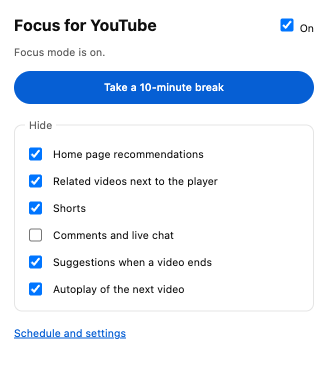
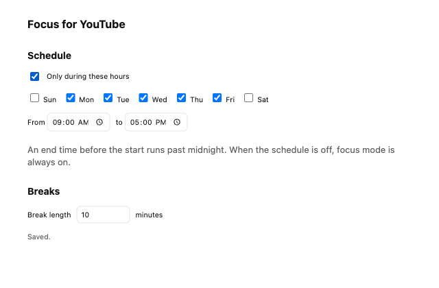

# Focus for YouTube

[](https://github.com/narinehzargarian/focus-for-youtube/actions/workflows/ci.yml)
[](LICENSE)
[](https://chromewebstore.google.com/detail/focus-for-youtube/njkoncfkhljmhjfpimpogbbhodmmegbj)

**[Add to Chrome](https://chromewebstore.google.com/detail/focus-for-youtube/njkoncfkhljmhjfpimpogbbhodmmegbj)**

A free, open-source Chrome extension that hides the parts of YouTube built to keep you watching, so you can watch what you came for and leave.

| Hidden by default | Can also hide |
| --- | --- |
| Home page recommendations | Comments and live chat |
| Related videos next to the player | |
| Shorts, including channel Shorts tabs (Shorts links open in the normal player) | |
| Suggestions when a video ends | |
| Autoplay of the next video | |

Search, your subscriptions, playlists, and the video itself all work as usual.

- **Breaks.** One click in the popup shows everything for 10 minutes (or however long you set), then focus mode comes back on its own.
- **Schedule.** Turn focus mode on only during set hours, such as weekdays 9 to 5. Overnight ranges like 22:00 to 02:00 work too.
- **No flashing.** Hiding is done with CSS that loads before the page draws, so recommendations never appear and then disappear.
- **Private.** No accounts, no tracking, no network requests. Settings are stored by Chrome and sync across your signed-in browsers. See [PRIVACY.md](PRIVACY.md).

<p>
  
  
</p>

## Install

### From the Chrome Web Store

Open [Focus for YouTube on the Chrome Web Store](https://chromewebstore.google.com/detail/focus-for-youtube/njkoncfkhljmhjfpimpogbbhodmmegbj) and click **Add to Chrome**. Updates install automatically.

### From GitHub

1. Download `focus-for-youtube-<version>.zip` from the [latest release](https://github.com/narinehzargarian/focus-for-youtube/releases/latest) and unzip it.
2. Open `chrome://extensions` and turn on **Developer mode** (top right).
3. Click **Load unpacked** and choose the unzipped folder.
4. Pin the extension from the puzzle-piece menu so the popup is one click away.

This works in Chrome 111 and later, and in other Chromium browsers such as Edge, Brave, and Arc.

### From source

```sh
git clone https://github.com/narinehzargarian/focus-for-youtube.git
cd focus-for-youtube
npm install
npm run build
```

Then load the `dist` folder with **Load unpacked**, as above.

## Use

Click the extension icon to:

- turn focus mode on or off,
- take a break, or end one early,
- choose what to hide.

**Schedule and settings** opens the options page, where you set the schedule and the break length.

Autoplay is turned off with YouTube's own autoplay switch, the same as clicking it yourself. If you want autoplay while focus mode is on, uncheck **Autoplay of the next video** in the popup. Otherwise the extension will switch it off again.

## Limits

- **youtube.com in a browser only.** It doesn't affect the YouTube apps, m.youtube.com, or YouTube embedded on other sites.
- **YouTube changes its pages.** When it renames the parts this extension hides, something can reappear until the extension is updated. The rules are in one file, [`src/content.css`](src/content.css), and `npm run test:live` checks them against the real site. Please [open an issue](https://github.com/narinehzargarian/focus-for-youtube/issues) if you see something that should be hidden.
- **It's a nudge, not a lock.** Anyone can turn it off from the popup. That's on purpose.

## How it works

| File | What it does |
| --- | --- |
| `src/content.css` | The hiding rules. Each one applies only while a matching attribute is set on the page, such as `data-ytf-shorts`. |
| `src/content.ts` | Reads your settings and the schedule, and sets those attributes. Follows YouTube's in-page navigation and redirects Shorts links. |
| `src/autoplay.ts` | Turns off YouTube's autoplay switch and cancels the "Up next" countdown. It runs in the page's own context, because YouTube's player ignores clicks from an extension's isolated context. It reads only the page attribute, never your settings. |
| `src/settings.ts` | Settings, defaults, and the schedule logic. |
| `src/popup.*`, `src/options.*` | The popup and the options page. |
| `src/background.ts` | Saves default settings on install. |

The extension asks for one permission, `storage`, and runs only on `https://www.youtube.com/*`.

## Development

```sh
npm install
npx playwright install chromium
npm run build         # build into dist/
npm test              # unit tests (schedule, settings, Shorts links)
npm run test:e2e      # loads the extension into Chromium and tests it on saved copies of YouTube's pages
npm run test:live     # the same against the real youtube.com (not run in CI)
npm run zip           # package dist/ as a zip for a release
```

The browser tests serve saved copies of YouTube's page structure at youtube.com addresses, so CI doesn't depend on the live site. The live tests catch the case where YouTube has changed and the copies no longer match. Run them before a release.

See [CONTRIBUTING.md](CONTRIBUTING.md) for how to fix a selector when YouTube changes.

## License

[MIT](LICENSE). Not affiliated with or endorsed by YouTube or Google.
